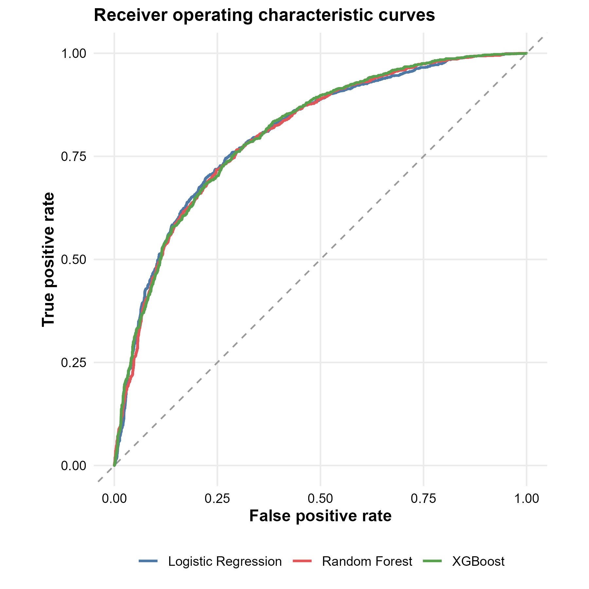
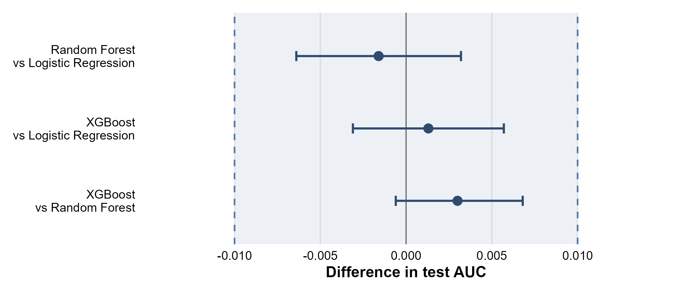
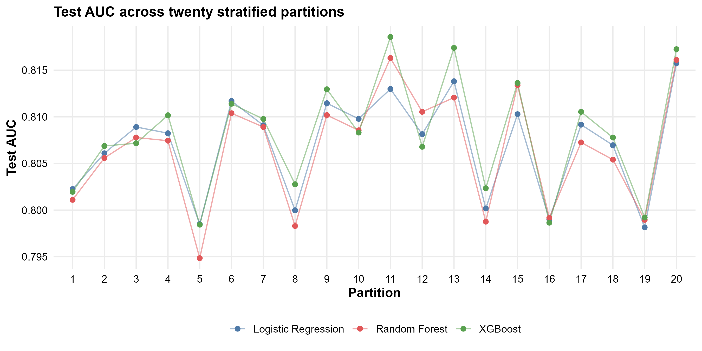
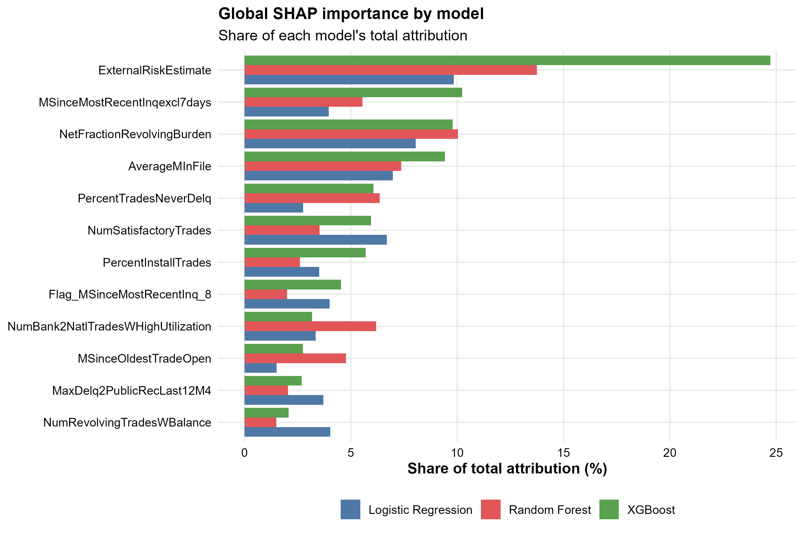
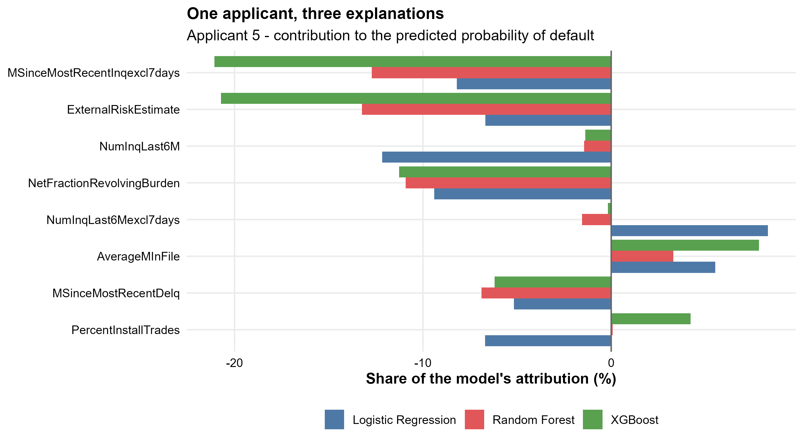

# Explainable AI in Credit Scoring

### The Role of Explainability in AI-Driven Lending Decisions: Evidence from Credit Scoring Models

A comparative analysis of Logistic Regression, Random Forest and XGBoost, examining predictive performance, statistical equivalence and the consistency of SHAP-based explanations in credit-risk assessment.

**Programme:** MSc Business Analytics, Queen’s University Belfast  
**Research focus:** Credit Risk Analytics | Explainable AI | Machine Learning | Financial Services  
**Dissertation grade:** 84/100

---

## Project Overview

Machine learning models can help financial institutions assess credit risk, but strong predictive performance does not necessarily mean that different models explain their decisions in the same way.

This project investigates that distinction using the FICO Explainable Machine Learning Challenge HELOC dataset. Three classification models—Logistic Regression, Random Forest and XGBoost—are developed and compared.

The research examines two questions:

1. Do the models achieve comparable predictive performance?
2. Do they identify similar factors when explaining predictions for individual applicants?

The key finding is that models can achieve comparable predictive performance while producing different explanations for the same applicant. This highlights why explainability should be considered alongside model performance in credit-risk applications.

## Dataset

The analysis uses the **FICO Explainable Machine Learning Challenge HELOC dataset**.

| Attribute | Description |
|---|---|
| Original observations | 10,459 |
| Predictors | 23 numerical features |
| Target variable | `RiskPerformance` |
| Target classes | Good / Bad |
| Final analytical sample | 9,870 observations |

The dataset contains special values indicating unavailable or unmet credit-information conditions:

- `-9`: No Bureau Record
- `-8`: No Usable/Valid Trades
- `-7`: Condition not Met

The final sample excludes 588 observations with no bureau record across all 23 predictors and one duplicate observation.

The original dataset is not included in this repository. Refer to [`data/README.md`](data/README.md) for dataset information and access guidance.

## Methodology

The project follows a supervised binary classification approach, covering data preparation, exploratory analysis, model development, evaluation and explainability.

### Models

| Model | Approach |
|---|---|
| Logistic Regression | L1-regularised logistic regression |
| Random Forest | Tree-based ensemble learning |
| XGBoost | Gradient-boosted decision trees |

The modelling process uses a stratified 70/30 training-test split, five-fold cross-validation and median imputation based on the training data.

### Evaluation

Model performance is assessed using:

- Accuracy
- Precision
- Recall
- F1-score
- ROC-AUC

The analysis also includes paired bootstrap AUC equivalence testing, repeated data partitions, sensitivity analysis and SHAP-based global and individual explanations.

## Predictive Performance

The following results were obtained on the test dataset.

| Metric | Logistic Regression | Random Forest | XGBoost |
|---|---:|---:|---:|
| Accuracy | 0.7365 | 0.7324 | 0.7328 |
| Precision | 0.7448 | 0.7292 | 0.7369 |
| Recall | 0.7506 | 0.7727 | 0.7565 |
| F1-score | 0.7477 | 0.7503 | 0.7466 |
| Test ROC-AUC | 0.8045 | 0.8029 | 0.8058 |
| Cross-validation AUC | 0.8042 | 0.8015 | 0.8080 |

The three models achieved similar predictive performance. XGBoost recorded the highest test ROC-AUC, while Random Forest achieved the highest recall.

### ROC Curve Comparison



## Statistical Equivalence Analysis

To investigate whether the differences in model performance were practically meaningful, the study used paired bootstrap equivalence testing.

The analysis applied an AUC equivalence margin of ±0.01, using 2,000 paired bootstrap resamples and 90% confidence intervals.

| Model Comparison | AUC Difference | 90% Confidence Interval |
|---|---:|---|
| Random Forest − Logistic Regression | -0.0016 | [-0.0064, 0.0032] |
| XGBoost − Logistic Regression | 0.0013 | [-0.0031, 0.0057] |
| XGBoost − Random Forest | 0.0030 | [-0.0006, 0.0068] |

All three confidence intervals fall within the selected equivalence bounds, providing evidence of comparable predictive performance under this evaluation procedure.

The equivalence margin was selected after exploratory analysis rather than preregistered, which should be considered when interpreting the results.



### Repeated Partition Analysis

Model performance was also evaluated across 20 repeated data partitions.

| Model | Mean AUC | Standard Deviation |
|---|---:|---:|
| Logistic Regression | 0.8070 | 0.0055 |
| Random Forest | 0.8066 | 0.0062 |
| XGBoost | 0.8081 | 0.0062 |



## Explainability Analysis

SHAP (SHapley Additive exPlanations) was used to examine how each model attributes its predictions to input features.

The analysis covers global feature importance, individual applicant explanations, agreement between models and explanation stability across retraining.

### Global Feature Importance

External Risk Estimate and Net Fraction Revolving Burden emerged as important features across the models.



### Individual Explanation Consistency

The models were compared on their agreement in identifying the principal contributing feature for individual applicants.

| Model Comparison | Agreement |
|---|---:|
| Logistic Regression – Random Forest | 44.3% |
| Logistic Regression – XGBoost | 43.3% |
| Random Forest – XGBoost | 78.3% |

For 38 of the 300 analysed applicants (12.7%), all three models identified different principal contributing features.

This is an important distinction: similar predictive performance does not necessarily result in consistent individual-level explanations.



**Important interpretation note:** Logistic Regression and XGBoost SHAP values are calculated on the log-odds scale, whereas Random Forest explanations use the probability scale. Their raw SHAP magnitudes should not be compared directly.

## Lending Decision Simulation

A threshold-based simulation was conducted to examine how different approval thresholds affect the number of bad outcomes among approved applicants.

The results below represent simulated bad outcomes per 1,000 approved applicants on the test dataset.

| Approval Threshold | Logistic Regression | Random Forest | XGBoost |
|---|---:|---:|---:|
| 50% | 286.5 | 288.5 | 289.9 |
| 60% | 331.6 | 334.5 | 339.0 |
| 70% | 384.7 | 385.1 | 387.5 |
| 80% | 434.5 | 436.7 | 433.7 |
| 90% | 482.0 | 480.5 | 478.6 |

These figures are simulation results based on model predictions, not observed lending outcomes.

## Key Takeaways

- **Predictive performance:** All three models achieved broadly comparable test ROC-AUC scores.
- **Statistical equivalence:** Pairwise bootstrap confidence intervals fell within the selected ±0.01 equivalence margin.
- **Explanation consistency:** Models sometimes identified different principal contributing features for the same applicant.
- **Global patterns:** External Risk Estimate and Net Fraction Revolving Burden were important across the models.
- **Business implications:** Comparable predictive performance does not guarantee identical explanations or lending decisions.

Overall, the research demonstrates why evaluating an AI model for credit-risk applications should involve more than predictive performance alone.

## Repository Structure

```text
explainable-ai-credit-scoring/
│
├── data/
│   └── README.md
│
├── scripts/
│   ├── README.md
│   ├── 01_data_preparation.R
│   ├── 02_models_and_metrics.R
│   ├── 03_robustness.R
│   ├── 04_shap_analysis.R
│   ├── 05_threshold_analysis.R
│   └── 06_figures_and_tables.R
│
├── results/
│   ├── README.md
│   ├── figures/
│   │   ├── 01_roc_curves.png
│   │   ├── 02_auc_equivalence.png
│   │   ├── 03_repeated_partition_auc.png
│   │   ├── 04_global_shap_importance.png
│   │   └── 05_local_shap_comparison.png
│   │
│   └── tables/
│       └── CSV result tables
│
└── README.md
```

## Reproducibility

The repository includes the R scripts, generated figures and exported result tables used in the research.

To reproduce the analysis:

1. Obtain the original HELOC dataset from its provider, subject to its applicable access and usage terms.
2. Review [`scripts/README.md`](scripts/README.md) for an overview of the scripts.
3. Install the R packages required by the individual scripts.
4. Update the dataset paths to match your local environment.
5. Execute the scripts in the order corresponding to the research workflow.

The original dataset is not redistributed here. Reproduction may require adapting file paths and ensuring that the required packages and input files are available.

## Limitations

The findings should be interpreted within the scope of the research design:

- The analysis uses a single benchmark credit-risk dataset and does not establish generalisability across all lending populations.
- The available dataset does not support a comprehensive protected-group fairness assessment.
- SHAP values represent model attributions, not causal explanations.
- The equivalence margin was selected after exploratory analysis.
- SHAP values from models using different output scales are not directly comparable in magnitude.
- The lending decision analysis is simulated, not based on actual lending outcomes.
- Explanation stability results require caution because the retraining procedure samples from the combined original training and test pool.

## Tools and Technologies

| Area | Tools / Methods |
|---|---|
| Programming | R |
| Machine Learning | Logistic Regression, Random Forest, XGBoost |
| Explainable AI | SHAP |
| Statistical Analysis | Bootstrap equivalence testing, cross-validation, sensitivity analysis |
| Visualisation | ggplot2 and related R packages |
| Data Analysis | Data preparation, exploratory analysis and model evaluation |

---

## Academic Context

Completed as part of the **MSc Business Analytics programme at Queen’s University Belfast**.

**Dissertation grade: 84/100**

*This repository presents an academic research and portfolio project. It is not intended to provide financial advice, automate real lending decisions or serve as a production-ready credit-scoring system.*
